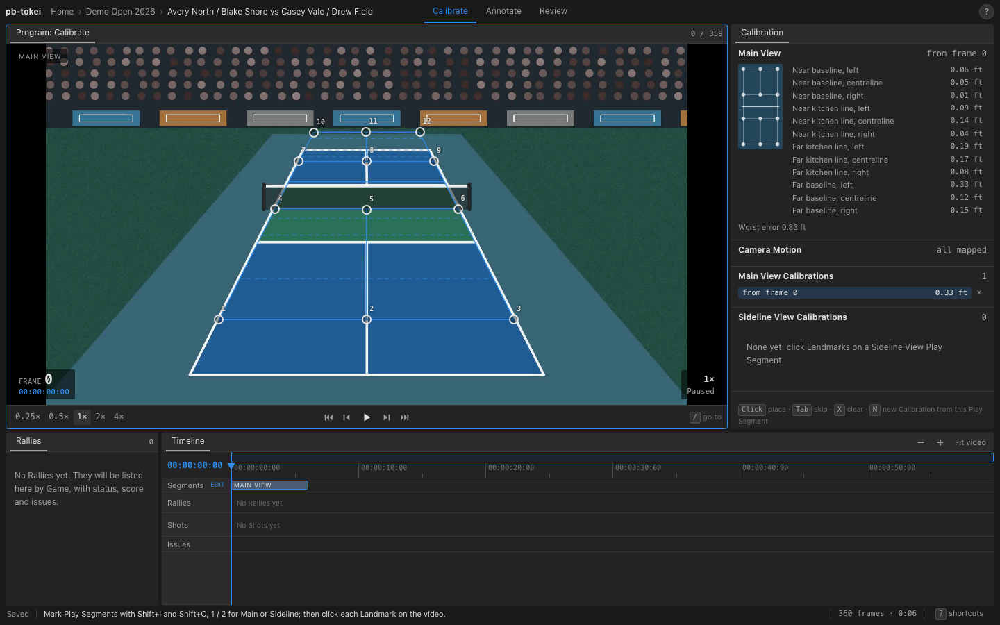

# pb-tokei

[](https://github.com/Eloyye/pb-tokei/actions/workflows/checks.yml)
[](.python-version)
[](LICENSE)

Statistics on professional side-out-scored doubles pickleball (PPA, APP, MLP), derived from recorded broadcast footage, for understanding how pros win and lose rallies.



You download a broadcast, set up the Match from a Roster File, then annotate it Rally by Rally in a local web app. Every Rally ends up in a Rally Log (a DuckDB file), and stats are derived from the Rally Log by rule. The words used throughout (Match, Rally, Play Segment, Calibration…) are defined in the [Glossary](GLOSSARY.md).

## Status

Works today:

- **Footage**: download a broadcast with `yt-dlp` and convert it to constant 60 fps for frame-exact seeking.
- **Matches**: set up a Match, with its Tournament, Teams and MLP Franchises, from a hand-written Roster File.
- **Annotation app**: list Matches and open each in a Premiere-style workspace with frame-by-frame playback, a zoomable Timeline and keyboard controls.
- **Calibrate**: mark Play Segments and their Camera View, fit the court from up to 12 Landmarks, and follow Camera Motion through each Play Segment.

Rally and Shot entry, stats and dashboards are next. Progress by milestone:

| Milestone | What it delivers | Status |
|---|---|---|
| [1: Ingest](https://github.com/Eloyye/pb-tokei/issues/3) | Footage download, 60 fps conversion, Match setup, the Rally Log | ✅ Done |
| [2: Manual Gold Annotation](https://github.com/Eloyye/pb-tokei/issues/8) | Calibration, Play Segments, Player positions, Rally and Shot entry, rule checks | 🚧 In progress |
| [3: Event Processing and the first dashboard page](https://github.com/Eloyye/pb-tokei/issues/15) | Derived facts, Shot Outcome rules, Team and Player stats, the Match report | Planned |
| [4: Benchmarks](https://github.com/Eloyye/pb-tokei/issues/21) | An annotated Gold Set and a benchmark harness | Planned |
| [5: Assisted pre-fill](https://github.com/Eloyye/pb-tokei/issues/24) | Models that pre-fill the Rally Log for an operator to review | Planned |
| [Later](https://github.com/Eloyye/pb-tokei/issues/31) | Ball tracking, Player movement, deferred decisions | Planned |

## Quick start

Runs on macOS and Linux (CI runs on Ubuntu). Windows is untested.

### Prerequisites

- [uv](https://docs.astral.sh/uv/getting-started/installation/). It installs Python 3.15 for you, so you don't need to install Python.
- [Bun](https://bun.sh), to build the annotation app's front end.
- [yt-dlp](https://github.com/yt-dlp/yt-dlp#installation) and [ffmpeg](https://ffmpeg.org/download.html), both on your `PATH`.
- [Chrome](https://www.google.com/chrome/), the only browser the annotation app supports.

### From clone to an open Match

```bash
git clone https://github.com/Eloyye/pb-tokei.git
cd pb-tokei
uv sync
cd web && bun install && bun run build && cd ..
```

Write a Roster File template, fill in the Tournament and the four Players, then create the Match. `match add` prints the new Match's id:

```bash
uv run pb-tokei match new rosters/<tournament>/<match>.toml
uv run pb-tokei match add rosters/<tournament>/<match>.toml
```

Download the broadcast and attach it to the Match. Then open the annotation app:

```bash
uv run pb-tokei download <url> --match <match-id>
uv run pb-tokei annotate
```

## Usage

Commands that read or write the Rally Log take `--db <path>`. The default is `rally_log.duckdb` in the directory you run them from.

### Footage

`download` saves a broadcast into `footage/` and converts it to a constant 60 fps MP4. `convert` re-runs the conversion on a file already on disk:

```bash
uv run pb-tokei download <url>
uv run pb-tokei download <url> --match <match-id> [--db rally_log.duckdb]
uv run pb-tokei download <url> --cookies-from-browser chrome   # or --cookies path/to/cookies.txt
uv run pb-tokei convert <path-to-original> [--force]
```

YouTube sometimes asks you to sign in to confirm you're not a bot. If it does, pass `--cookies-from-browser <browser>` (for example `chrome`, `firefox` or `safari`) or `--cookies <path>`. To set a default instead, add a line such as `--cookies-from-browser chrome` to `~/.config/yt-dlp/config`.

### Matches and Roster Files

A Roster File is a TOML file that sets up one Match: its Tournament, its two Teams and, for MLP, its Franchises. By convention they are kept in `rosters/`. `match new` writes a template with a fresh Match id, `match add` creates the Match it describes, and `match list` shows the Matches in the Rally Log:

```bash
uv run pb-tokei match new rosters/<tournament>/<match>.toml
uv run pb-tokei match add rosters/<tournament>/<match>.toml [--db rally_log.duckdb]
uv run pb-tokei match list [--tournament <name>] [--db rally_log.duckdb]
```

### Annotation app

A local web app for Chrome. It lists Matches and opens each in a Premiere-style workspace (Calibrate, Annotate, Review), with the Match's 60 fps video, a Timeline and keyboard playback:

```bash
uv run pb-tokei annotate [--db rally_log.duckdb] [--port 8000] [--no-browser]
```

The app serves on `127.0.0.1` only and opens your browser. Relative video paths are resolved from the directory you start it in, as with the other commands. If a Match has no playable video, the app shows the command that fixes it; it never downloads or converts anything itself.

Press `?` in the app for every key that works. The full layout and keymap, including planned keys, are in [docs/annotation-ui.md](docs/annotation-ui.md).

## Project layout

```
src/pb_tokei/      the Python package: CLI, Rally Log, footage, Calibration, Camera Motion
  annotate/        the annotation app's API server (it also serves the built front end)
web/               the annotation app's front end (React, TypeScript, Vite, Bun)
tests/             pytest suite
docs/
  adr/             architecture decision records
  annotation-ui.md the annotation app's layout, keys and interaction model
  design/          clickable UI prototypes
scripts/           developer check pages
GLOSSARY.md        the project's vocabulary
rosters/           your Roster Files (by convention; not in the repository)
footage/           downloaded broadcasts (local only, gitignored)
```

## Contributing

Issues are welcome. Setup, checks, the front-end dev loop and how to propose changes are in [CONTRIBUTING.md](CONTRIBUTING.md).

## License

Licensed under the [Apache License 2.0](LICENSE).
